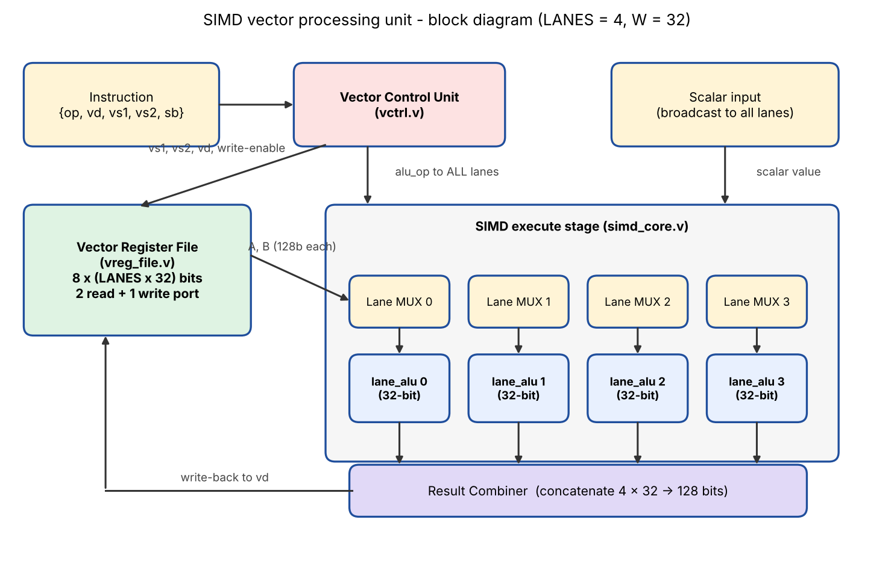
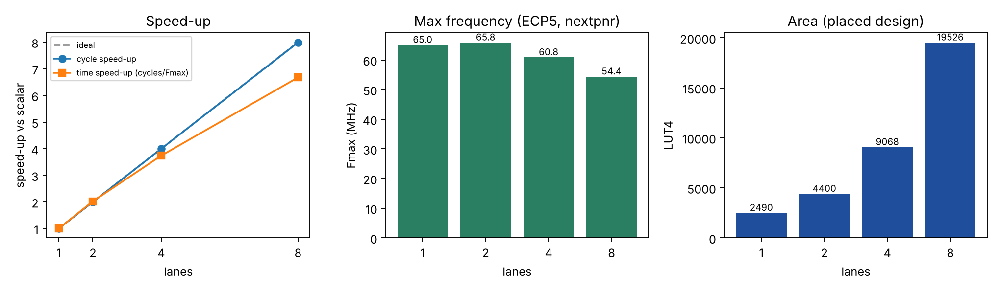
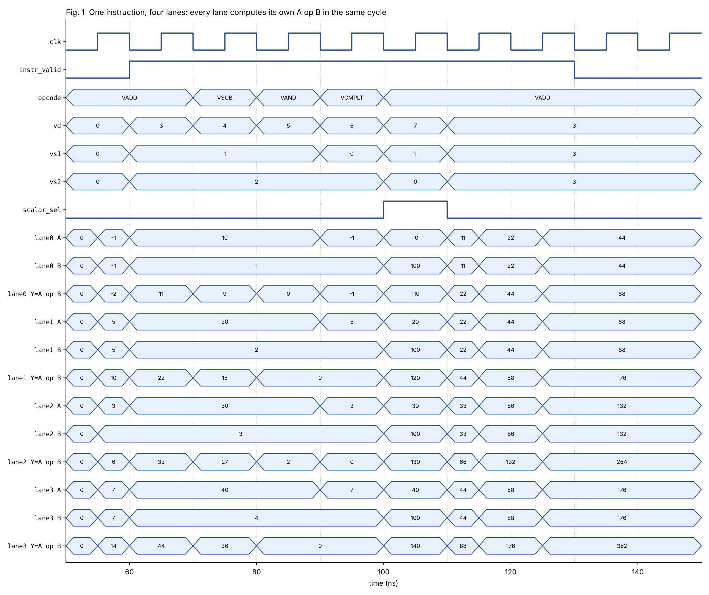
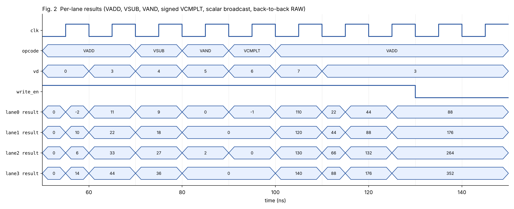
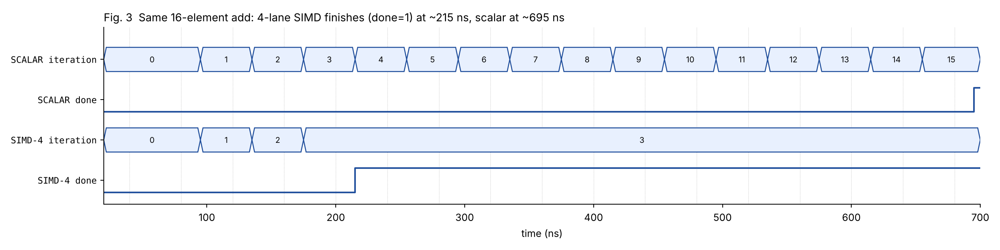

# SIMD Vector Processing Unit in Verilog

**Modern Computer Architecture - Project 11 (Level: Intermediate+)**

| | |
|---|---|
| Demo video | _paste the unlisted YouTube / Drive link here_ |
| IEEE report | [report/main.pdf](report/main.pdf) (LaTeX source: [report/main.tex](report/main.tex)) |
| Language / tools | Verilog-2001/2005, Icarus Verilog 12, Yosys 0.33, nextpnr-ecp5 0.6, Python 3 + matplotlib |

A parameterised SIMD unit (1, 2, 4 or 8 lanes x 32 bit) with a vector register file, control unit, per-lane operand MUXes, a result
combiner and a scalar-broadcast interface. A **separate scalar machine** runs the same workload on the same data. We measure
**cycle count, speed-up, throughput, maximum frequency and FPGA resource usage**, and verify the design with self-checking testbenches.

---

## 1. What the assignment asked for and where it is in this repo

| Requirement from the brief | Where it is |
|---|---|
| Vector register file | `rtl/vreg_file.v` |
| Multiple ALUs (lanes) | `rtl/lane_alu.v`, replicated by a `generate` loop in `rtl/simd_core.v` |
| Vector control unit | `rtl/vctrl.v` |
| Lane MUXes | per-lane operand-B mux in `rtl/simd_core.v` (register or broadcast scalar) |
| Result combiner | concatenation of lane outputs in `rtl/simd_core.v` |
| Optional scalar interface | `scalar_in` port + `sb` instruction bit (broadcast to all lanes); VMOV with `sb=1` writes a scalar into every lane |
| Operations: ADD, SUB, AND, OR, comparison (+ shifts, multiply) | opcodes 0-10: VADD VSUB VAND VOR VXOR VCMPEQ VCMPLT VSLL VSRL VMUL VMOV |
| Four or eight lanes | `LANES` parameter; **1, 2, 4 and 8 are all simulated and verified** |
| Scalar and SIMD versions of the same workload | `rtl/scalar_top.v` (scalar machine) vs `rtl/bench_top.v` (SIMD machine), `tb/tb_compare.v` runs both on the same data |
| Verify vector results | `tb/tb_simd_core.v` (system) + unit testbenches, golden model, coverage matrix |
| Cycle count, throughput | `results/compare.txt`, `results/summary.md` |
| FPGA resource usage | `results/fmax.csv` (LUT4, FF, MULT18), `results/pnr_L*.log` |
| Maximum frequency | `results/fmax.csv` (nextpnr static timing) |
| Deliverable: SIMD RTL | `rtl/` |
| Deliverable: vector testbench | `tb/` |
| Deliverable: scalar-vs-SIMD timing comparison | Section 5 below, report Table II-III |
| Deliverable: resource utilization and Fmax | Section 6 below, report Table III |
| Evaluation: correct lane operation / parallel execution | waveforms in `docs/waveforms/` (Section 7), lane-independence tests |
| Evaluation: verification coverage | coverage matrix in Section 4, `results/test_log.txt` |
| Evaluation: quantitative performance analysis | Sections 5-6, report |

Full checklist with line-level detail: [docs/BRIEF_COMPLIANCE.md](docs/BRIEF_COMPLIANCE.md).

---

## 2. Concept in one minute

A **scalar** processor does `C[i] = A[i] + B[i]` one element at a time. A **SIMD** unit has several identical ALUs ("lanes") under
one control unit; one `VADD` instruction adds a whole vector, e.g. 4 elements, in one step. This is **data-level parallelism**.
Speed-up comes from doing `LANES` operations per cycle, not from a faster clock. It costs area (more ALUs, wider registers, more
memory bandwidth) and slightly lowers the clock frequency.

## 3. Architecture



| Module | File | What it does |
|---|---|---|
| Lane ALU | `rtl/lane_alu.v` | One 32-bit ALU. 11 operations. Compares return all-ones (true) or 0 (false). Less-than is signed. |
| Vector register file | `rtl/vreg_file.v` | 8 registers x (LANES x 32) bits; 3 combinational read ports, 1 synchronous write port, async reset. |
| Control unit | `rtl/vctrl.v` | Splits the 14-bit instruction into fields; write-enable only for legal opcodes (0-10). |
| SIMD core | `rtl/simd_core.v` | Generate-loop of LANES (operand MUX + ALU), result combiner, write-port arbitration (load port has priority). |
| SIMD benchmark machine | `rtl/bench_top.v` | Wide memories + FSM (LDA, LDB, EXEC, ST) running `C = A op B` on the SIMD core. |
| Scalar machine | `rtl/scalar_top.v` | 1 ALU (same `lane_alu`), 3 registers, same FSM and cycle rules, one element per load. |

**Instruction format (14 bits):** `[13:10] opcode | [9:7] vd | [6:4] vs1 | [3:1] vs2 | [0] sb` (sb = 1 -> operand B is the scalar input).
The opcode **is** the ALU operation, so the control unit needs no decode table. Lane *i* is `vector[i*32 +: 32]`.

| Op | Name | Per-lane operation | Op | Name | Per-lane operation |
|---|---|---|---|---|---|
| 0 | VADD | a+b | 6 | VCMPLT | signed a<b -> all-ones / 0 |
| 1 | VSUB | a-b | 7 | VSLL | a << b[4:0] |
| 2 | VAND | a&b | 8 | VSRL | a >> b[4:0] |
| 3 | VOR | a\|b | 9 | VMUL | low 32 bits of a*b |
| 4 | VXOR | a^b | 10 | VMOV | b |
| 5 | VCMPEQ | a==b -> all-ones / 0 | 11-15 | - | NOP (no write) |

**Fair-comparison rules** (both machines): same ALU module, same clock, 4 cycles per iteration (load A, load B, execute, store C),
cycles counted from the start handshake until `done` rises. Hence scalar = `4N+1`, SIMD = `4*ceil(N/LANES)+1`. The only difference
is how many elements each load/execute/store handles.

## 4. Verification

| Testbench | Tests | Checks |
|---|---|---|
| `tb_lane_alu.v` | **exhaustive** 8-bit (all 65,536 operand pairs x 11 ops), illegal opcodes, 32-bit corner + random | 753,901 |
| `tb_vreg_file.v` | reset, write/read all regs, we=0 holds, isolation (random writes), read-during-write = old value, async reset | 1,636 |
| `tb_vctrl.v` | all 16 opcodes, random register fields, valid=0, scalar bit | 8,000 |
| `tb_simd_core.v` | directed, corner (0, all-ones, +/- extremes), 2000 random/opcode, scalar broadcast, **lane independence**, back-to-back RAW, accumulate, illegal opcode; for 1/2/4/8 lanes | 26,525 / 28,725 / 36,425 / 65,025 |
| `tb_compare.v` | scalar and SIMD machines, same data, 5 operations, every output element of both checked | 10,240 per lane count |
| `tb_bench.v` | lane-scaling benchmark of the SIMD machine | 5,120 per lane count |

**Does the testbench catch bugs?** Six deliberate faults (unsigned compare, wrong subtract, arithmetic shift, lane crosstalk,
illegal-opcode write, scalar mux disabled) were injected into the RTL; **all six were detected**.

**Coverage matrix** printed by `tb_simd_core.v` (vectors tested per opcode x test type, 4 lanes):

```
op      directed  corner  random  scalar  lane-ind   RAW
VADD          1      64    2000     200      400   500
VSUB          1      64    2000     200      400   500
VAND          1      64    2000     200      400     0
VOR           1      64    2000     200      400     0
VXOR          1      64    2000     200      400   500
VCMPEQ        1      64    2000     200      400     0
VCMPLT        1      64    2000     200      400     0
VSLL          1      64    2000     200      400     0
VSRL          1      64    2000     200      400     0
VMUL          1      64    2000     200      400     0
VMOV          1      64    2000     200      400     0
```
Dependent-instruction (RAW) chains use VADD, VSUB and VXOR; the datapath hazard behaviour is identical for every opcode because all
results go through the same write-back path. All logs: [results/test_log.txt](results/test_log.txt).

## 5. Scalar vs SIMD: cycles and throughput (N = 1024, C = A + B)

Simulation, identical data, both outputs checked against a golden model:

| Lanes | Scalar cycles | SIMD cycles | Cycle speed-up | Efficiency | Elements / cycle |
|---|---|---|---|---|---|
| 1 | 4097 | 4097 | 1.00x | 100% | 0.250 |
| 2 | 4097 | 2049 | 2.00x | 100% | 0.500 |
| 4 | 4097 | 1025 | 4.00x | 99.9% | 0.999 |
| 8 | 4097 | 513 | 7.99x | 99.8% | 1.996 |

**Why the speed-up is almost exactly the lane count:** the memory returns a whole vector per cycle, so bandwidth grows with lanes and
the loop has the same 4 steps for every lane count. A real fixed-width memory bus and non-vector work would reduce it (Amdahl's law).

## 6. Maximum frequency, resources, execution time (Yosys + nextpnr-ecp5, Lattice ECP5-85k model)

| Lanes | Cycles | Fmax (MHz) | Time (us) | Throughput (M elem/s) | Time speed-up | LUT4 | FF | MULT18 |
|---|---|---|---|---|---|---|---|---|
| 1 (scalar ref.) | 4097 | 65.0 | 63.0 | 16.3 | 1.00x | 2490 | 375 | 3 |
| 2 | 2049 | 65.8 | 31.1 | 32.9 | 2.02x | 4400 | 695 | 6 |
| 4 | 1025 | 60.8 | 16.8 | 60.8 | 3.74x | 9068 | 1335 | 12 |
| 8 | 513 | 54.4 | 9.4 | 108.5 | 6.67x | 19526 | 2615 | 24 |



* **Execution time = cycles / Fmax; throughput = N / time.** Fmax drops as lanes grow (wider read muxes, higher fan-out, longer routing), so
  the real speed-up (6.67x at 8 lanes) is below the cycle speed-up (7.99x).
* Area grows almost linearly with lanes.
* **Honesty note:** no Vivado/Quartus was available, so Fmax and area come from an **open-source flow on an ECP5 model** (seed 1, 100 MHz target).
  Absolute MHz differ from Xilinx/Intel; differences of 1-2 MHz (e.g. 2 lanes vs 1 lane) are placement noise. The scalar reference time uses the 1-lane clock.
* To get vendor numbers: Vivado -> add `rtl/*.v`, top `simd_core`, `create_clock -period 10 [get_ports clk]`, Fmax ~ 1/(10 ns - WNS).

## 7. Waveforms (generated without GTKWave)

`make waves` turns the simulation VCD into PNGs with Python ([docs/WAVEFORM_GUIDE.md](docs/WAVEFORM_GUIDE.md) lists other viewers).

**Fig 1 - one instruction, four lanes, same clock cycle.** Sequence: VADD, VSUB, VAND, signed VCMPLT, VADD with broadcast scalar 100, two
back-to-back dependent VADDs. Only lane 0 is true for `-1 < 1`; the chain gives 11 -> 22 -> 44 -> 88 in lane 0.


**Fig 2 - per-lane results.**


**Fig 3 - same 16-element job: scalar finishes at ~695 ns (16 iterations), 4-lane SIMD at ~215 ns (4 iterations).**


## 8. How to run

Requirements: `iverilog` (v11+), `make`, Python 3 + `matplotlib`. Optional: `yosys`, `nextpnr-ecp5` (`sudo apt install iverilog yosys nextpnr-ecp5`).

```bash
make test       # unit tests (ALU, register file, control) + system tests for 1,2,4,8 lanes; any FAIL stops the build
make compare    # scalar machine vs SIMD machine, same data -> results/compare.txt
make bench      # lane scaling of the SIMD machine -> results/bench.txt, speedup.txt
make waves      # waveform PNGs -> docs/waveforms/
make fmax       # Fmax + resources with Yosys + nextpnr (several minutes) -> results/fmax.csv
make tables     # cycles + Fmax -> execution time, throughput -> results/summary.md
make clean
```
Windows without `make`: use Git Bash/WSL, or run by hand, e.g.
```bat
iverilog -g2012 -o sim\core rtl\lane_alu.v rtl\vreg_file.v rtl\vctrl.v rtl\simd_core.v tb\tb_simd_core.v
cd sim && vvp core
```
Change lane count: `iverilog -g2012 -Ptb_simd_core.LANES=8 ...` (testbenches) or the `LANES` parameter on `simd_core`.

## 9. Repository layout
```
rtl/        lane_alu.v  vreg_file.v  vctrl.v  simd_core.v  bench_top.v  scalar_top.v
tb/         tb_lane_alu.v  tb_vreg_file.v  tb_vctrl.v  tb_simd_core.v  tb_compare.v  tb_bench.v  tb_waves.v
scripts/    vcd_to_png.py  make_waveforms.py  make_tables.py  make_charts.py  make_diagram.py  fmax.sh  synth.sh
synth/      fmax_wrap.v   (timing wrapper used only for the Fmax flow)
results/    test_log.txt  compare.txt  bench.txt  fmax.csv  summary.md  pnr_L*.log  synth_L*.rpt
docs/       diagrams/  waveforms/  ISA.md  BRIEF_COMPLIANCE.md  TEAM_WORKFLOW.md  VIDEO_SCRIPT.md  VIVA_QA.md  WAVEFORM_GUIDE.md ...
report/     main.tex  main.pdf  figures/
video/      README.md (video link)
.github/workflows/ci.yml   (runs the simulations on every push)
```

## 10. Team and individual contributions

| Member | Name | Enrollment| Design / code | Verification / results | Report sections |
|---|---|---|---|---|---|
| 1 | Harshita| 2401020026 | `simd_core.v` integration, Makefile, CI, repo setup | integration run, clean-clone check | Abstract, Introduction, Discussion, assembly, vedio |
| 2 | Yashi Agarwal | 2401010516 | `lane_alu.v`, block-diagram script | `tb_lane_alu.v` (exhaustive) | ISA + lane ALU section, Fig. 1 block diagram |
| 3 | Manan Gilhotra | 2401020038 | RTL: `vreg_file.v`, `lane_alu.v`, `vctrl.v`, `simd_core.v`, `scalar_top.v`; `fmax_wrap.v`, `fmax.sh` | `tb_vreg_file.v`, Fmax/area for 1-8 lanes | Literature review, Experimental setup |
| 4 | Akhil Mishra | 2401010051 | `vctrl.v`, ISA document | `tb_vctrl.v`, `tb_simd_core.v`, coverage, fault injection | Verification |
| 5 | _name_ | _@id_ | `scalar_top.v`, `bench_top.v`, plotting/table scripts | `tb_bench.v`, `tb_compare.v`, `tb_waves.v`, waveforms, analysis | Scalar machine + benchmark, Results |

Each member also has a personal step-by-step guide with the exact code to paste into GitHub (`MEMBER_N_GUIDE.md`, shared separately from this repo).
The presentation video is delivered by one team member (all five are introduced in it).

## 11. Limitations and future work
Single-cycle execute (no pipelining); memory modelled as wide arrays so bandwidth scales with lanes; `N` is padded to a multiple of the
lane count; Fmax from an open-source ECP5 flow, single seed, not a vendor tool. Future: pipelined execute stage, vector-length register,
masking/predication, strided memory access, Vivado/Quartus timing on a Xilinx/Intel device.

## 12. References
Listed in the report ([report/main.tex](report/main.tex)): Flynn (1966, 1972), Russell (Cray-1, 1978), Hennessy & Patterson (2019), Peleg & Weiser (MMX, 1996),
Stephens et al. (ARM SVE, 2017), RISC-V Vector Extension 1.0, Lindholm et al. (NVIDIA Tesla, 2008), Yu et al. (2008), Yiannacouras et al. (VESPA, 2008), Amdahl (1967).

## 13. License
MIT, see [LICENSE](LICENSE).
